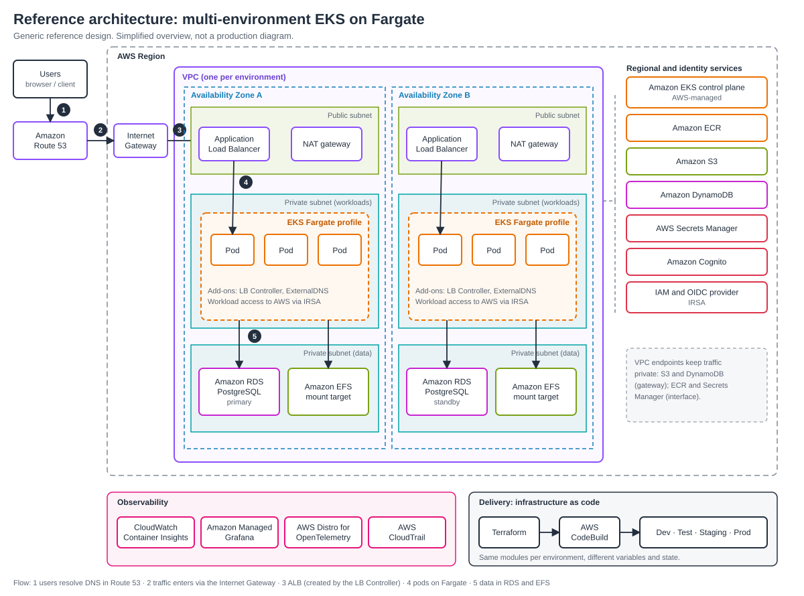

# eks-fargate-landing-zone

[](https://github.com/MusaveerHolalkere25/eks-fargate-landing-zone/actions/workflows/terraform.yml)
[](LICENSE)

A Terraform reference for a **multi-environment Amazon EKS platform on AWS Fargate**: VPC, serverless Kubernetes with no nodes to patch, IAM roles for service accounts (IRSA), and observability with Container Insights and Amazon Managed Grafana.

> An independent reference design, written from public AWS documentation for learning and demonstration. The ADOT collector configuration follows the AWS reference configuration for Container Insights on EKS Fargate. It is simplified and not a production-ready platform. Review and test everything before using it for real workloads.



## What's included

| Path | What it does |
| --- | --- |
| `modules/vpc` | VPC, public and private subnets across AZs, Internet Gateway, one shared or per-AZ NAT gateway, S3 gateway endpoint, EKS subnet tags, closed default security group |
| `modules/eks-fargate` | EKS cluster, control plane logging, OIDC provider, Fargate profiles, CoreDNS on Fargate, kube-proxy and VPC CNI add-ons, CloudWatch Logs permissions for Fargate log routing |
| `modules/irsa` | IAM role that a single Kubernetes service account can assume, with optional managed and inline policies |
| `modules/observability` | Fargate log routing (Fluent Bit to CloudWatch), ADOT collector for Container Insights metrics, Managed Grafana workspace with a service account |
| `modules/amg_dashboards` | CloudWatch data source and an "EKS Fargate overview" dashboard, defined in Terraform |
| `envs/dev` | VPC, EKS and observability with dev-sized settings |
| `envs/dev-dashboards` | Grafana data source and dashboard (second stack, see below) |

## Quick start

Prerequisites: Terraform 1.10 or later, the AWS CLI, `kubectl`, AWS credentials for a **personal or sandbox account**, and **IAM Identity Center enabled** in that account (Managed Grafana uses it for login).

### 1. Platform and observability

```bash
cd envs/dev
cp terraform.tfvars.example terraform.tfvars   # set api_access_cidrs and grafana_admin_user_ids
cp backend.tf.example backend.tf               # optional: remote state in S3
terraform init
terraform apply
```

Then check the cluster:

```bash
aws eks update-kubeconfig --region eu-west-1 --name eks-fargate-lz-dev
kubectl get pods -A      # CoreDNS and adot-collector should be Running
```

### 2. Dashboards

Dashboards live in a separate stack because the Grafana provider needs the workspace URL and token, which only exist after step 1.

```bash
cd ../dev-dashboards
export TF_VAR_grafana_endpoint="$(terraform -chdir=../dev output -raw grafana_endpoint)"
export TF_VAR_grafana_auth="$(terraform -chdir=../dev output -raw grafana_service_account_token)"
terraform init
terraform apply
```

Open the Grafana endpoint, sign in with IAM Identity Center, and open **EKS Fargate overview**. Pod metrics can take a few minutes to appear. Pod logs appear in the CloudWatch log group `/aws/eks/<cluster>/fargate-logs` for pods in namespaces covered by a Fargate profile.

### 3. Clean up

```bash
cd envs/dev-dashboards && terraform destroy
cd ../dev && terraform destroy
```

**Cost warning:** the EKS control plane and NAT gateway bill hourly. Managed Grafana bills per active user, Container Insights per custom metric, and CloudWatch for log ingestion and storage. Destroy the environment after testing.

## Using the IRSA module

```hcl
module "app_role" {
  source = "../../modules/irsa"

  name              = "my-app"
  oidc_provider_arn = module.eks.oidc_provider_arn
  oidc_provider_url = module.eks.oidc_provider_url
  namespace         = "default"
  service_account   = "my-app"

  policy_arns = {
    s3_read = "arn:aws:iam::aws:policy/AmazonS3ReadOnlyAccess"
  }
}
```

Then annotate the Kubernetes service account with `eks.amazonaws.com/role-arn` set to `module.app_role.role_arn`.

## Design decisions

- **Fargate over managed nodes:** no node patching or capacity planning, and pod-level isolation. Trade-offs: no DaemonSets, no privileged pods, a higher cost per vCPU, and slower pod start.
- **IRSA over node roles:** each workload gets its own narrowly scoped role. The ADOT collector can only write Container Insights logs and metrics for this cluster.
- **ADOT instead of the CloudWatch agent:** the standard Container Insights agent runs as a DaemonSet, which Fargate does not support. A single ADOT collector scrapes cAdvisor through the API server instead.
- **Built-in Fluent Bit for logs:** Fargate routes pod logs with no sidecar. The namespace label `aws-observability: enabled` and the `aws-logging` ConfigMap switch it on, and the pod execution role needs CloudWatch Logs permissions.
- **Service-managed Grafana permissions:** AWS creates and scopes the workspace role for the CloudWatch data source, so there are no broad hand-written policies.
- **Dashboards in a separate stack:** the Grafana provider needs a workspace URL and token that don't exist until the first stack is applied.
- **Private subnets for pods, one NAT in dev:** only load balancers live in public subnets. `single_nat_gateway` trades resilience for cost.
- **Restricted API endpoint:** `api_access_cidrs` has no default, so the public API is never open to the world by accident.

## Quality checks

GitHub Actions runs on every push and pull request: `terraform fmt`, `terraform validate` per environment, TFLint, and Checkov. Checkov currently reports findings without failing the build while they are triaged. Run `terraform fmt -recursive` before committing.

## Roadmap

- [ ] `envs/prod` (NAT per AZ, 3 AZs, tighter API access)
- [ ] AWS Load Balancer Controller and ExternalDNS (Helm)
- [ ] RDS PostgreSQL and EFS example
- [ ] VPC flow logs and interface endpoints (ECR, Secrets Manager)
- [ ] Example workload using an IRSA-annotated service account
- [ ] Alerting (CloudWatch alarms or Grafana alert rules)

## Author

Built by [Musaveer Holalkere](https://musaveerholalkere25.github.io), Cloud & DevOps Engineer. [LinkedIn](https://www.linkedin.com/in/musaveerah)

## License

[MIT](LICENSE)
